<div align="center">

# ⚡ Helper-AI
### Autonomous AI Agent with Full PC & Internet Control

*Give Helper a goal. It executes, self-heals, and works until the job is done—without endless questioning.*

[](https://opensource.org/licenses/MIT)
[](https://www.python.org/downloads/)
[](https://github.com/rajkotpodman/helper-AI/actions/workflows/ci.yml)
[](https://github.com/rajkotpodman/helper-AI/actions/workflows/docker-build.yml)
[](https://fastapi.tiangolo.com)
[]()
[]()

<br>

📖 **[ગુજરાતી ભાષામાં સંપૂર્ણ માર્ગદર્શિકા (Comprehensive Gujarati Guide)](HOW_TO_USE.md)**

</div>

---

## 🏗️ System Architecture

```mermaid
flowchart TD
    User([User Goal / Voice Input]) --> Frontend[Web Dashboard / CLI Runner / WebSocket]
    Frontend --> Core[HelperAgent ReAct Planning Engine]
    
    subgraph Brain[Multi-Model Intelligence & Memory]
        Core <--> LLM[Multi-Provider Client\nGemini 1.5/Flash • OpenAI GPT-4o • Groq • Ollama • RuleEngine]
        Core <--> Memory[AgentMemory & Markdown Recorder\n20MB Auto-Rotation]
        Core <--> Perm[PermissionManager\n1-Click Human-in-the-Loop]
    end

    subgraph Observability[Enterprise Observability]
        Core --> Audit[AuditLogger\nStructured JSONL + Token Redaction]
        Core --> Metrics[TelemetryCollector\nLatency, System Uptime, Error Rates]
    end

    subgraph Tools[Arsenal of 18 Native & Extensible Tools]
        Core --> PSTool[PowerShell & Shell Runner]
        Core --> FileTool[Smart File System Resolver]
        Core --> SysTool[Process & Health Diagnostics]
        Core --> WebTool[DuckDuckGo Search & Scraper]
        Core --> BrowserTool[Selenium Project Browser\nFacebook / LinkedIn / Blogger]
        Core --> GUITool[PyAutoGUI Desktop Control\nMouse, Keyboard, Hotkeys]
        Core --> VoiceTool[Edge-TTS Voice Engine]
        Core --> VisionTool[Playwright Visual DOM Inspector]
        Core --> MCPTool[Model Context Protocol Client]
    end
```



---

## 🌟 What is Helper-AI?

**Helper-AI** is a production-grade autonomous personal AI agent designed to bridge the gap between high-level human intent and real operating system execution. Unlike conversational chatbots that only respond with text suggestions, **Helper-AI takes direct action on your PC and the internet**.

Whether you need to clean up unorganized folders, diagnose system bottlenecks, research web topics and synthesize reports to your Desktop, publish social media updates, or execute complex administrative PowerShell tasks—**Helper autonomously plans the workflow, executes the actions, observes output, self-heals around errors, and stops only when your goal is fully verified.**

---

## 🎯 Key Capabilities & Arsenal

### 💻 1. Operating System & Terminal Control
- **PowerShell & Shell Automation:** Executes native PowerShell, CMD, or Bash commands with timeout handling and safety guardrails.
- **Smart Filesystem Operations:** Reads, writes, moves, searches, and organizes files. Automatically resolves user aliases like `Desktop`, `Downloads`, and `Documents`.
- **System Health & Process Diagnostics:** Real-time CPU, RAM, Disk telemetry with the ability to locate, filter, and terminate unresponsive processes.
- **Desktop Application Launcher:** Spawns native applications (Notepad, Calculator, Chrome) or file associations directly.

### 🌐 2. Web & Social Media Automation
- **Social Media Publishing Pipeline:** Drafts and publishes updates on Facebook, X/Twitter, LinkedIn, Threads, and Reddit with automated modal handling.
- **Persistent Browser Profile:** Employs a dedicated persistent user data directory (`chrome_profile`) maintaining login sessions across agent runs.
- **Challenge & Security Detection:** Autonomously detects CAPTCHAs, two-factor authentication, and Cloudflare Turnstile verification screens, triggering 1-click Human-in-the-Loop resolution.
- **Live Internet Research:** Queries DuckDuckGo for real-time web answers and extracts clean, ad-free markdown content from target websites.
- **Direct File Downloads:** Streams and stores web assets directly to specified local directories.

### 🖱️ 3. Desktop GUI & Mouse Control
- **Precise Mouse Actions:** Clicks, double clicks, right clicks, drags, and scrolls anywhere on the primary or secondary monitors.
- **Keyboard Simulation:** Types strings, triggers single keys, and dispatches hotkeys (`Ctrl+C`, `Ctrl+V`, `Alt+Tab`, `Win+R`).
- **Active Window Inspection:** Lists visible open application windows and geometry coordinates.

### 🗣️ 4. Neural Voice & Visual Perception
- **Edge-TTS Neural Voice Engine:** Generates natural, human-like speech output across dozens of global voices, languages, and accents at zero cost.
- **Playwright Visual Perception:** Takes high-resolution viewport snapshots and captures atomic DOM state for visual decision-making.

### 🔌 5. Model Context Protocol (MCP) Extensibility
- Implements Anthropic's **Model Context Protocol (MCP)** specification via `mcp_servers.json`, allowing dynamic integration of third-party external tools into the agent's runtime registry.

### 🛡️ 6. 1-Click Human-in-the-Loop (HITL) Authorization
- **Non-Technical One-Click Approvals:** High-risk actions (social posting, permanent deletions) pause execution and display a clean approval dialog on the Web Dashboard.
- **REST & WebSocket API:** Allows mobile webhooks or external applications to authorize or deny actions with a single request (`/api/permission/respond`).

### 🧠 7. Persistent Markdown Memory & 20 MB Auto-Rotation
- **Automatic Interaction Logging:** Logs all goals, status verdicts, step counts, and final replies to [`agent_memory.md`](agent_memory.md).
- **20 MB Auto-Archive Threshold:** When the memory file reaches 20 MB, Helper-AI prompts the user, archives a timestamped backup, and resets the active log for clean continuity.

---

## 🧰 Complete Arsenal: All 25 Registered Tools

| Tool Name | Category | Description |
| :--- | :--- | :--- |
| `audit_security_baseline` | Security | Audits defensive security baselines, firewall profiles, open ports, patches, and service hardening |
| `deep_web_crawl` | Web | Recursively crawls websites, documentation portals, and knowledge bases into clean markdown dossiers |
| `batch_fetch_web` | Web | Concurrently fetches multiple web pages or search results in parallel |
| `fetch_github_repo` | Web | Deeply inspects and fetches entire GitHub codebases, raw trees, files, README, and releases |
| `fetch_web_content` | Web | Extracts clean, readable text from target URLs with dynamic browser fallback for JS SPAs |
| `duckduckgo_search` | Web | Queries DuckDuckGo for live internet snippets without API keys |
| `download_file` | Web | Streams and downloads binary files directly to designated local paths |
| `execute_python_code` | Code | Dedicated Python execution sandbox with automatic pip dependency installation |
| `build_project_files` | Code | Scaffolds and writes entire multi-file projects, directory trees, and configurations in 1 atomic step |
| `execute_powershell` | System | Executes native PowerShell or terminal scripts with stdout/stderr capture and auto-quoting |
| `read_file` | File | Reads text content from files across the host filesystem |
| `write_file` | File | Creates or overwrites files with provided text content |
| `list_directory` | File | Lists children files, folders, and sizes in a target path (supports paths with spaces) |
| `search_files` | File | Recursively searches for files matching wildcards or extensions |
| `move_or_copy_file` | File | Moves, renames, or copies files and directories |
| `process_manager` | System | Enumerates running processes and terminates target PIDs |
| `system_health` | System | Retrieves real-time CPU load, memory percentages, and disk stats |
| `open_application` | Apps | Launches applications, documents, or custom URLs |
| `manage_ollama` | AI | Manages local Ollama models, pulls models, and inspects status |
| `check_connections` | Network | Comprehensive multi-pass network and API connectivity diagnostics |
| `browser_automation`| Browser | Controls Selenium Project Browser for social media, Blogger, and web forms |
| `desktop_gui_control`| GUI | Controls mouse cursor, keyboard hotkeys, and window geometry |
| `text_to_speech` | Voice | Generates natural neural speech audio using Microsoft Edge-TTS |
| `vision_browser` | Vision | Captures visual screenshots and DOM state via Playwright |
| `mcp_tool` | Extensibility | Dispatches requests to external Model Context Protocol servers |

---

## 🚀 Quick Start Guide

### 1. The 1-Click Windows Starter (Recommended)
1. Clone or download this repository.
2. Double-click **`start.bat`**.
3. Your default browser will launch at `http://localhost:8000`.
4. Enter your goal and click **🚀 Execute Goal**!

---

### 2. Manual Installation (Developers & Power Users)

```bash
# 1. Clone repository
git clone https://github.com/rajkotpodman/helper-AI.git
cd helper-AI

# 2. Create virtual environment
python -m venv .venv
# On Windows:
.venv\Scripts\activate
# On Linux/macOS:
source .venv/bin/activate

# 3. Install dependencies
pip install -r requirements.txt
```

### 3. Environment Configuration

Copy `.env.example` to `.env`:
```bash
cp .env.example .env
```

Set your preferred provider:
```ini
LLM_PROVIDER=gemini       # Options: gemini, openai, groq, ollama, rule_engine
GEMINI_API_KEY=your_gemini_api_key
GEMINI_MODEL=gemini-flash-latest
SAFE_MODE=false
PORT=8000
HOST=0.0.0.0
```

*(Note: Helper-AI operates 100% offline without any API keys using the built-in Smart Rule Engine or local Ollama!)*

### 4. Launch the Interfaces

#### 🌐 Web Dashboard (FastAPI + Glassmorphism UI)
```bash
python app.py
```
Open `http://localhost:8000` in your browser.

#### 🖥️ Interactive Command Line (CLI Mode)
```bash
# Direct goal execution
python helper.py "Check PC health and CPU, and write a summary to Desktop/health.txt"

# Web research and synthesis
python helper.py "Search web for top open-source AI agents and save report to Desktop/report.md"

# Interactive loop
python helper.py
```

---

## 🐳 Docker Deployment & Orchestration

Run Helper-AI in an isolated containerized environment:

```bash
# Production Docker Compose
docker compose up -d

# Development Docker Compose with Live Code Reloading
docker compose -f docker-compose.dev.yml up -d

# Check container logs
docker compose logs -f
```

The service will be accessible at `http://localhost:8000`.

---

## 📡 REST API Reference

| Method | Endpoint | Description |
| :--- | :--- | :--- |
| `GET` | `/api/status` | System health check, active LLM provider, and safe mode status |
| `GET` | `/api/tools` | Enumerates all 18 registered tools with JSON schemas |
| `GET` | `/api/metrics` | Telemetry metrics: latency percentiles, step counts, error rates |
| `GET` | `/api/audit` | Retrieves structured audit trail logs with secret masking |
| `GET` | `/api/memory/stats` | Returns `agent_memory.md` file size and 20MB quota status |
| `GET` | `/api/memory/download`| Downloads the persistent memory markdown file |
| `POST`| `/api/memory/reset` | Triggers manual backup archive and memory file reset |
| `GET` | `/api/permission/pending` | Lists pending Human-in-the-Loop authorization requests |
| `POST`| `/api/permission/respond` | Approves or denies a pending authorization request |
| `WS`  | `/ws/agent` | Real-time WebSocket connection streaming thoughts, actions, and output |

---

## 🧪 Automated Testing Suite

We maintain 100% test coverage across all tools, agents, safety filters, and APIs:

```bash
# Run complete test suite (65 passing tests)
pytest tests/ -v

# Run with coverage analysis
pytest --cov=core tests/
```

On Linux or CI environments without an active X11 display:
```bash
xvfb-run --auto-servernum pytest tests/ -v
```

---

## 🤝 Community & Governance

- [Contributing Guidelines](CONTRIBUTING.md)
- [Code of Conduct](CODE_OF_CONDUCT.md)
- [Security Policy](SECURITY.md)
- [Changelog](CHANGELOG.md)
- [Gujarati Usage Guide](HOW_TO_USE.md)

---

## 📄 License

Distributed under the [MIT License](LICENSE).
