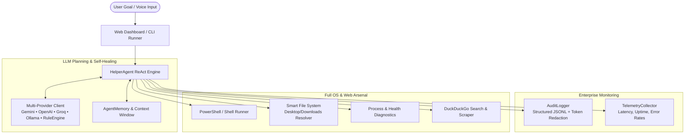

<div align="center">

# ⚡ Helper-AI
### Autonomous AI Agent with Full PC & Internet Control

*Give Helper a goal. It executes, self-heals, and works until the job is done—without endless questioning.*

[](https://opensource.org/licenses/MIT)
[](https://www.python.org/downloads/)
[](https://github.com/rajkotpodman/helper-AI/actions/workflows/ci.yml)
[](https://fastapi.tiangolo.com)
[]()
[]()
<br><br>
📖 **[ગુજરાતી ભાષામાં સંપૂર્ણ માર્ગદર્શિકા (Gujarati Guide)](HOW_TO_USE.md)**

</div>

---

## 🏗️ System Architecture



---

## 🌟 What is Helper-AI?

**Helper-AI** is an autonomous personal AI agent designed to bridge the gap between high-level human goals and real operating system actions. Unlike basic chatbots that only answer questions with text, **Helper-AI takes direct action on your PC and the internet**.

Whether you need to clean up messy folders, diagnose system performance, research an internet topic and save a summary report to your Desktop, or run complex PowerShell tasks—**Helper plans the steps, runs the tools, inspects the results, fixes errors on the fly, and stops only when your goal is accomplished.**

---

## 🎯 Key Capabilities

### 💻 1. Full Running PC Control
- **PowerShell & Terminal Automation:** Executes PowerShell/CMD commands, tests tools, installs software, and manages services.
- **Smart File System Operations:** Reads, writes, moves, searches, and organizes files. Recognizes shortcuts like `Desktop`, `Downloads`, and `Documents` automatically.
- **Process & Health Monitoring:** Real-time CPU, RAM, and Disk inspection with the ability to locate and terminate frozen processes.
- **App & Document Launching:** Opens desktop apps, URLs, folders, or documents seamlessly.

### 🌐 2. Internet & Browser Automation
- **Browser Automation & Social Media:** Prepares and launches draft posts for Twitter/X, LinkedIn, Threads, Reddit, Facebook, and interacts with web forms.
- **Dedicated Persistent Profile:** Uses a safe persistent browser profile so your logins and sessions remain intact across runs.
- **Challenge & Verification Detection:** Automatically detects CAPTCHAs, two-factor authentication, or security verification screens and prompts for seamless Human-in-the-Loop resolution.
- **Built-in Web Search:** Searches DuckDuckGo for live internet answers and documentation without requiring any paid search API keys.
- **Web Content Extraction:** Fetches and parses articles, documentation, or websites into clean, ad-free text.
- **Direct File Downloads:** Streams and downloads files directly from the web into designated folders.

### 🛡️ 3. 1-Click Human-in-the-Loop (HITL) Authorization
- **Non-Technical One-Click Approvals:** Whenever high-risk commands or social media publications are queued, Helper-AI pauses and displays a clean 1-click authorization modal in the Web Dashboard.
- **REST & WebSocket API:** Allows external apps or mobile webhooks to authorize or deny actions with a single request via `/api/permission/respond`.
- **Autonomous & Safe:** Provides full autonomous power without sacrificing user safety or control.

### 🧠 4. Persistent Markdown Memory & 20 MB Auto-Rotation
- **Automatic Interaction Logging:** Logs every user prompt/goal, execution status, steps taken, and final agent reply directly into a simple, human-readable [`agent_memory.md`](agent_memory.md) file.
- **20 MB Memory Threshold:** Continuously monitors memory file size. When the file reaches 20 MB, Helper-AI prompts the user to copy and store the file, automatically creates a backup archive, and resets the active file to start a fresh 20 MB memory log.
- **One-Click Download & Reset:** Easily view live memory size, download the `.md` log, or reset memory from the Web Dashboard or API.

### 🚀 5. Autonomous "No-Questions" Execution
- **Autonomous ReAct Engine:** Plans → Acts → Observes → Self-Corrects.
- **Error Recovery:** If a command fails or a file isn't found, Helper analyzes the error and formulates an alternative approach instead of giving up.
- **Non-Technical Friendly:** Features both a **1-click Web Dashboard** and a powerful CLI. Anyone can use it without prior coding knowledge.

---

## 🚀 Quick Start (Non-Technical Users)

### Option A: The 1-Click Starter (Windows)
1. Download or clone this repository to your computer.
2. Double-click **`start.bat`**.
3. Your browser will automatically launch with the **Helper-AI Web Dashboard** (`http://localhost:8000`).
4. Type your goal and click **Execute Goal**!

---

## 🛠️ Quick Start (Developers & Power Users)

### 1. Clone & Install Dependencies
```bash
git clone https://github.com/rajkotpodman/helper-AI.git
cd helper-AI
pip install -r requirements.txt
```

### 2. Configure Environment (Optional)
Copy `.env.example` to `.env`:
```bash
cp .env.example .env
```
Set your preferred provider:
```ini
LLM_PROVIDER=gemini       # Options: gemini, openai, groq, ollama, rule_engine
GEMINI_API_KEY=your_key_here
```
*(Note: Helper-AI works even without an API key using the built-in Smart Rule Engine for standard PC and web tasks!)*

### 3. Launch the Web Dashboard
```bash
python app.py
```
Visit `http://localhost:8000` in your browser.

### 4. Or Run Directly from Terminal (CLI Mode)
```bash
# Direct goal execution
python helper.py "Check my PC health, CPU, and RAM, and write a summary to Desktop/health.txt"

# Search web and save report
python helper.py "Search the web for top open-source AI agents and save a report to Desktop/report.md"

# Interactive prompt
python helper.py
```

---

## 🧩 Supported AI Models

| Provider | Model | Description |
| :--- | :--- | :--- |
| **Google Gemini** | `gemini-1.5-flash` | *(Recommended)* Blazing fast, huge context window, inexpensive or free tier. |
| **OpenAI** | `gpt-4o` / `gpt-4o-mini` | State of the art reasoning and planning. |
| **Groq** | `llama-3.3-70b-versatile` | Ultra-low latency execution. |
| **Ollama** | `llama3.2` / `mistral` | **100% Offline & Private.** Runs locally on your machine with zero data leaving your PC. |
| **Rule Engine** | *Built-in* | Zero setup fallback for standard PC diagnostics, file management, and web searches. |

---

## 📁 Project Structure

```text
helper-AI/
├── app.py                  # Web Dashboard server (FastAPI + WebSocket)
├── helper.py               # CLI runner for power users
├── start.bat               # 1-click Windows launcher
├── requirements.txt        # Python package dependencies
├── .env.example            # Environment settings template
├── LICENSE                 # MIT License
├── core/
│   ├── agent.py            # Autonomous ReAct agent loop
│   ├── llm.py              # Multi-provider LLM interface (Gemini/OpenAI/Groq/Ollama)
│   ├── memory.py           # Context and execution trajectory manager
│   └── tools/              # PC and Internet tool implementations
│       ├── base.py         # Base tool schema & abstract class
│       ├── system_tools.py # PowerShell runner, system health, process manager
│       ├── file_tools.py   # Smart file reader, writer, search, and organizer
│       └── web_tools.py    # DuckDuckGo search, web scraper, downloader
└── static/
    ├── css/style.css       # Modern dark-mode glassmorphism interface
    ├── js/app.js           # Live WebSocket and agent controller
    └── index.html          # Web dashboard interface
```

---

## 🐳 Docker Deployment

Run Helper-AI in a secure containerized environment:

```bash
# Build and run with Docker Compose
docker compose up -d

# Or build standalone image
docker build -t helper-ai:latest .
docker run -p 8000:8000 --env-file .env helper-ai:latest
```

---

## 🧪 Automated Testing & Quality

Helper-AI includes an automated test suite verifying tool execution, safety restrictions, API endpoints, and memory retention:

```bash
# Run complete test suite
pytest tests/ -v

# Run with coverage report
pytest --cov=core tests/
```

---

## 📊 Telemetry & Audit Logs

- **Structured JSONL Audit Trail:** Stored at `logs/audit.jsonl` with token and password masking.
- **Live Metrics API:** Access operational telemetry at `GET http://localhost:8000/api/metrics`.
- **History Export:** Download execution history in Markdown or JSON format directly from the web dashboard.

---

## 🛡️ Safety & Autonomous Guardrails

Helper-AI provides two operating modes:
- **Full Autonomous Mode (Default):** Runs commands and solves problems without interrupting you with questions.
- **Safe Mode:** Can be toggled on in Settings or with `--safe` in CLI. It restricts potentially destructive PowerShell commands (such as recursive drive format or deletion).

---

## 🤝 Community & Governance

- [Contributing Guidelines](CONTRIBUTING.md)
- [Code of Conduct](CODE_OF_CONDUCT.md)
- [Security Policy](SECURITY.md)
- [Changelog](CHANGELOG.md)

---

## 📄 License

This project is licensed under the [MIT License](LICENSE).
