<div align="center">

# ⚡ Helper-AI
### The Autonomous AI Agent with Full PC & Internet Control
**Run anything on your computer, automate the web, and solve complex tasks simply by typing what you want in plain English.**

*Give Helper-AI a goal. It creates a plan, runs the right tools, self-heals around errors, and delivers 100% completed results—without endless questions.*

[](https://opensource.org/licenses/MIT)
[](https://www.python.org/downloads/)
[](https://github.com/rajkotpodman/helper-AI/actions/workflows/ci.yml)
[](https://github.com/rajkotpodman/helper-AI/actions/workflows/docker-build.yml)
[](https://fastapi.tiangolo.com)
[]()
[]()

<br>

[📖 Non-Technical User Manual](HOW_TO_USE.md) • [🇮🇳 ગુજરાતી માર્ગદર્શિકા (Gujarati Guide)](HOW_TO_USE.md#-%E0%AA%97%E0%AB%81%E0%AA%9C%E0%AA%B0%E0%AA%BE%E0%AA%A4%E0%AB%80-%E0%AA%B5%E0%AA%BF%E0%AA%AD%E0%AA%BE%E0%AA%97-gujarati-section) • [🛡️ Security Toolkit](security_toolkit/README.md) • [📋 Changelog](CHANGELOG.md)

</div>

---

## 🌟 What is Helper-AI? (Explained for Everyone)

Imagine having a smart personal computer assistant sitting beside you. Instead of just talking to you like ChatGPT, **Helper-AI actually does the work for you on your computer**:

- **Organizes your messy files:** Finds files scattered across your Downloads or Desktop and neatly groups them.
- **Surfs the web and writes reports:** Researches any topic online and saves a clean, formatted report directly onto your Desktop.
- **Checks your computer's health:** Tells you how much RAM, CPU, or hard drive space you have left and safely closes frozen programs.
- **Controls the browser and social media:** Can log into websites, draft and publish posts on LinkedIn, Facebook, or Blogger, and fill out forms.
- **Runs terminal and system commands:** Works across Windows, Mac, and Linux, adapting to whichever operating system you are using.
- **Performs defensive security audits:** Scans open ports, audits web security headers, and alerts you if sensitive system files have been modified.
- **Never gives up:** If a program gives an error, Helper-AI reads the error, changes its approach, and keeps working until the goal is achieved!

---

## ⚡ The 3-Minute Beginner Quickstart (No Technical Skills Needed!)

You don't need to know any programming, coding, or terminal commands to use Helper-AI. Follow these simple steps:

### Step 1: Install Python (Takes 1 Minute)
If you don't already have Python on your computer:
1. Visit the official Python download page: **[https://www.python.org/downloads/](https://www.python.org/downloads/)**
2. Download and run the installer for your computer.
3. ⚠️ **VERY IMPORTANT:** On the very first screen of the installer, check the small box at the bottom that says **"Add Python to PATH"** (or "Add python.exe to PATH").
4. Click **Install Now**.

### Step 2: Download Helper-AI
1. Click the green **Code** button at the top right of this GitHub page and select **Download ZIP**.
2. Unzip the downloaded folder to any place on your computer (for example, on your `Desktop` or `C:\` or `E:\` drive).

### Step 3: Start Helper-AI with 1 Click
- **On Windows:** Open the unzipped folder and **double-click the `start.bat` file**.
- **On Linux or Mac:** Open a terminal in the folder and type:
  ```bash
  python app.py
  ```

### Step 4: Use the Beautiful Web Screen
A black window will start up for a few seconds, and your default web browser will automatically open up:
👉 **`http://localhost:8000`**

You will see the Helper-AI dashboard. Simply type what you want in plain English into the goal box and press **🚀 Execute Goal**!

---

## 🖥️ What the Web Dashboard Looks Like

```text
+-----------------------------------------------------------------------------------------+
| ⚡ Helper-AI                     [● System Ready]      [⚙️ Settings]      [🛡️ Safe Mode]  |
+-----------------------------------------------------------------------------------------+
|                                                                                         |
|   🎯 What goal would you like Helper to achieve?                                        |
|   +---------------------------------------------------------------------------------+   |
|   | Type your goal in plain human language... (e.g. "Clean up my Downloads folder") |   |
|   +---------------------------------------------------------------------------------+   |
|                                                                                         |
|   Quick Ideas:                                                                          |
|   [💻 Check PC Health]  [🔍 Research Web & Save Report]  [📂 Clean Downloads Folder]     |
|   [🛡️ Audit Open Ports]  [🌐 List GitHub Repositories]   [📝 Write & Publish Blog Post]  |
|                                                                                         |
|   Status: Ready (RuleEngine Offline Mode Active)         [⏹ Stop Agent] [🚀 Execute Goal]|
+-----------------------------------------------------------------------------------------+
| 📊 Real-Time Execution Feed                                                             |
|   Step 1: 💭 Thought: "I need to check the Downloads directory and group files by type."|
|           ⚡ Action: list_directory(path="Downloads")                                   |
|           📋 Result: Found 24 files (10 images, 8 PDFs, 6 installers)                   |
|   Step 2: 💭 Thought: "Creating folders and organizing files..."                        |
|   ...                                                                                   |
|   🎉 MISSION ACCOMPLISHED! Your files have been organized into neat subfolders.         |
+-----------------------------------------------------------------------------------------+
```

---

## 💡 Practical Examples of What You Can Tell Helper-AI

Here are real tasks you can copy and paste into Helper-AI right now:

### 📁 1. Files & Organization
- `"Look at my Downloads folder, create subfolders for 'Images', 'Documents', and 'Installers', and move the files into them."`
- `"Find all files larger than 100 MB on my computer and make a list on my Desktop."`
- `"Search for all files with '.log' in their name and delete them."`

### 💻 2. Computer Health & Performance
- `"Check my PC health: how much CPU and RAM am I using? Save a summary to Desktop/health.txt."`
- `"Check if any process is freezing or using more than 80% CPU and list them."`
- `"Close or kill the application using port 8000 so I can free it up."`

### 🌐 3. Web Research & Reports
- `"Search the internet for the top 5 artificial intelligence news stories this week and save a detailed report to Desktop/ai_news.md."`
- `"Fetch the text of the webpage https://example.com and summarize it in 10 bullet points."`
- `"Download the latest cheat sheet for ffmpeg or docker and save it locally."`

### 📱 4. Social Media & Content Publishing
- `"Draft an informative LinkedIn post about autonomous AI agents and publish it to my feed."`
- `"Create a Facebook post summarizing our newest product launch and publish it."`
- `"Write a 5-paragraph blog post about python tips and publish it to Blogger."`

### 🛡️ 5. Security & System Auditing
- `"Run a defensive security audit on my computer and check which network ports are open."`
- `"Audit the web security headers of http://localhost:8000 and give me a scorecard."`
- `"Create a cryptographic baseline of my project directory so I know if any file gets tampered with."`

---

## 🏗️ System Architecture

```mermaid
flowchart TD
    User([User Goal: Plain English or Voice]) --> Frontend[Web Dashboard / CLI Runner / REST API]
    Frontend --> Core[HelperAgent Autonomous ReAct Planning Engine]
    
    subgraph Brain[Multi-Model Intelligence & Memory]
        Core <--> LLM[Multi-Provider Client\nGemini 2.5/Flash • OpenAI GPT-4o • Groq • Ollama • RuleEngine]
        Core <--> Memory[AgentMemory & Markdown Recorder\n20MB Auto-Rotation]
        Core <--> Perm[PermissionManager\n1-Click Human Approval Dialog]
    end

    subgraph Observability[Enterprise Observability]
        Core --> Audit[AuditLogger\nStructured JSONL + Token Redaction]
        Core --> Metrics[TelemetryCollector\nLatency, System Uptime, Error Rates]
    end

    subgraph Arsenal[Arsenal of 32 Native & Extensible Tools]
        Core --> UniversalTerm[Universal Cross-Platform Terminal Engine]
        Core --> OSCommand[OS-Adaptive Command Synthesizer]
        Core --> CmdHub[Command Hub & Cheatsheet Downloader]
        Core --> SecAudit[Security Baseline & Port Hardening]
        Core --> Superpowers[Superpower Research, Orchestration & Code Studio]
        Core --> FileTools[Smart Filesystem: Read, Write, Search, Move]
        Core --> WebTools[Live DuckDuckGo, Deep Crawler & Batch Fetcher]
        Core --> BrowserTool[Selenium Persistent Project Browser]
        Core --> GUITool[PyAutoGUI Desktop Mouse & Keyboard Control]
        Core --> VoiceTool[Edge-TTS Neural Voice Engine]
        Core --> VisionTool[Playwright Visual Perception]
        Core --> MCPTool[Model Context Protocol Client]
    end
```



---

## 🧰 Complete Arsenal: All 32 Registered Tools

Helper-AI comes built-in with **32 specialized tools**. The agent automatically selects the right tool for each step:

| # | Tool Name | Category | What It Does (Simple Explanation) |
| :-: | :--- | :--- | :--- |
| 1 | **`universal_terminal`** | System | Runs any terminal or PowerShell command on Windows, Linux, or Mac; supports heavy background tasks. |
| 2 | **`synthesize_os_command`** | System | Translates plain English intentions into exact, safe commands for your specific operating system. |
| 3 | **`command_hub`** | System | Downloads, searches, and caches community command cheat sheets (from cheat.sh and encyclopedia). |
| 4 | **`audit_security_baseline`** | Security | Audits open network ports, firewall status, security patches, and system hardening posture. |
| 5 | **`deep_web_crawl`** | Web | Recursively crawls websites and documentation portals into full, structured markdown knowledge files. |
| 6 | **`batch_fetch_web`** | Web | Concurrently downloads and extracts multiple web pages in parallel. |
| 7 | **`fetch_github_repo`** | Web | Inspects any GitHub repository, fetching files, folder trees, README, releases, and codebases. |
| 8 | **`fetch_web_content`** | Web | Extracts clean, readable article text from any web address without ads or clutter. |
| 9 | **`duckduckgo_search`** | Web | Searches the live internet for answers without needing any paid search API keys. |
| 10 | **`download_file`** | Web | Downloads files or documents directly from the internet onto your computer. |
| 11 | **`execute_python_code`** | Code | Runs Python scripts in an isolated sandbox with automatic dependency installation. |
| 12 | **`build_project_files`** | Code | Scaffolds and writes entire multi-file software projects and folder trees in 1 step. |
| 13 | **`execute_powershell`** | System | Executes native PowerShell scripts with automatic quoting for paths with spaces. |
| 14 | **`read_file`** | Files | Reads and inspects the contents of text, code, or configuration files. |
| 15 | **`write_file`** | Files | Creates new files or overwrites existing files with clean text. |
| 16 | **`list_directory`** | Files | Lists all files, folders, and sizes inside any directory (e.g. Desktop, Downloads). |
| 17 | **`search_files`** | Files | Searches for files by name, extension, or keyword across your drives. |
| 18 | **`move_or_copy_file`** | Files | Renames, moves, or makes duplicates of files and folders safely. |
| 19 | **`process_manager`** | System | Lists running programs and safely terminates frozen or unresponsive processes. |
| 20 | **`system_health`** | System | Checks CPU load, RAM usage, hard drive capacity, and computer uptime. |
| 21 | **`open_application`** | Apps | Opens desktop applications like Edge, Chrome, Notepad, Calculator, or Spotify. |
| 22 | **`manage_ollama`** | AI | Pulls, runs, and lists local AI models so you can run Helper-AI 100% offline. |
| 23 | **`check_connections`** | Network | Checks internet, Google Translate, Chrome port 9222, and API status with zero hassle. |
| 24 | **`browser_automation`** | Browser | Controls the dedicated browser to log in, navigate, click, fill forms, and post on social media. |
| 25 | **`desktop_gui_control`** | GUI | Simulates human mouse clicks, keyboard typing, hotkeys (`Ctrl+C`, `Win+R`), and window management. |
| 26 | **`text_to_speech`** | Voice | Speaks answers aloud using Microsoft's neural voice engine across dozens of natural accents. |
| 27 | **`vision_browser`** | Vision | Takes high-resolution screenshots and captures webpage visual layout using Playwright. |
| 28 | **`mcp_tool`** | Extensibility| Connects to external Model Context Protocol (MCP) servers to add new third-party tools. |
| 29 | **`deep_research_studio`** | Superpower | Multi-query search expansion, parallel distillation, and executive intelligence dossier synthesis. |
| 30 | **`orchestrate_complex_goal`** | Superpower | Structures massive tasks into 5-phase execution pipelines (Discovery -> Architecture -> Execution -> Verification -> Delivery). |
| 31 | **`code_studio_builder`** | Superpower | Builds multi-file projects in 1 step with automated AST syntax checking and sandbox verification. |
| 32 | **`system_super_optimizer`** | Superpower | Introspective PC diagnostics, memory optimization analysis, network latency testing, and junk file scanning. |

---

## ⚙️ AI Models & Free Offline Mode

Helper-AI works with **any AI provider** you prefer:

| Mode / Provider | Internet Needed? | Cost | How to Use |
| :--- | :---: | :---: | :--- |
| **Smart Rule Engine** *(Built-in)* | ❌ No | **100% Free** | Default out-of-the-box mode! No API keys or credit card needed. |
| **Google Gemini** | ✅ Yes | **Free Tier Available** | Get a free key at [Google AI Studio](https://aistudio.google.com/), add `GEMINI_API_KEY` in `.env`. |
| **Ollama Local AI** | ❌ No | **100% Free** | Install [Ollama](https://ollama.com/), run `ollama pull qwen2.5:1.5b`. Works 100% private on your machine. |
| **OpenAI (GPT-4o)** | ✅ Yes | Paid API | Add `OPENAI_API_KEY` in `.env`. |
| **Groq (Ultra-Fast)** | ✅ Yes | Free Tier Available | Add `GROQ_API_KEY` in `.env`. |

### How to configure your AI key (Optional):
1. Rename or copy `.env.example` to `.env`.
2. Open `.env` in Notepad and set:
   ```ini
   LLM_PROVIDER=gemini
   GEMINI_API_KEY=your_actual_key_here
   ```
3. Save the file. That's it!

---

## 🛡️ Safe Mode & 1-Click Approvals (Human-in-the-Loop)

You never have to worry about the agent doing something destructive:
- **Destructive Action Blocker:** In Safe Mode (`SAFE_MODE=true`), commands that format disks or wipe system folders are automatically blocked before they can ever run.
- **1-Click Approvals:** If Helper-AI is about to publish a post on social media or delete a file, it pauses and shows a friendly approval pop-up on your screen asking:  
  *`"Helper-AI wants to publish this LinkedIn post. Do you approve? [Yes] / [No]"`*
- You remain in complete control at all times!

---

## ❓ Frequently Asked Questions (FAQ) for Beginners

### Q1: Is Helper-AI free?
**Yes!** Helper-AI is 100% open-source under the MIT license. You can use it completely free forever.

### Q2: Do I have to pay for an AI API key?
**No!** Helper-AI comes with a built-in deterministic Smart Rule Engine and supports free local Ollama AI models. You can run it 100% offline without spending a penny.

### Q3: When I double-click `start.bat`, nothing happens or it closes immediately. What should I do?
Make sure Python is installed and that you checked the box **"Add Python to PATH"** during installation. You can test this by opening PowerShell or Command Prompt and typing:
```powershell
python --version
```
If it prints `Python 3.10` or higher, you are good to go!

### Q4: How do I stop an ongoing task?
Simply click the red **`⏹ Stop Agent`** button on the web dashboard at any time. Helper-AI will stop immediately.

### Q5: Can Helper-AI speak to me?
**Yes!** You can ask Helper-AI: `"Speak aloud: Welcome to my computer!"` and it will use its built-in neural text-to-speech engine to speak aloud in a natural human voice.

---

## 🧪 Automated Testing Suite

We maintain an exhaustive automated test suite with **153+ passing tests** covering every tool, network adapter, security module, and browser controller:

```bash
# Run the complete test suite
pytest tests/ -v

# Run the security toolkit tests
pytest tests/test_security_toolkit.py -v

# Run the universal cross-platform terminal tests
pytest tests/test_universal_terminal.py -v
```

---

## 🤝 Community & Support

- **Detailed User Guide:** Read the [HOW_TO_USE.md](HOW_TO_USE.md) guide for in-depth examples in English and Gujarati.
- **Security Inquiries:** Review our [SECURITY.md](SECURITY.md) policy.
- **Contributing:** Read our [CONTRIBUTING.md](CONTRIBUTING.md) guide to help build new features.
- **Release History:** Check our [CHANGELOG.md](CHANGELOG.md) for all updates.

---

## 📄 License

Distributed under the open-source **[MIT License](LICENSE)**. Free to use, modify, and distribute.
